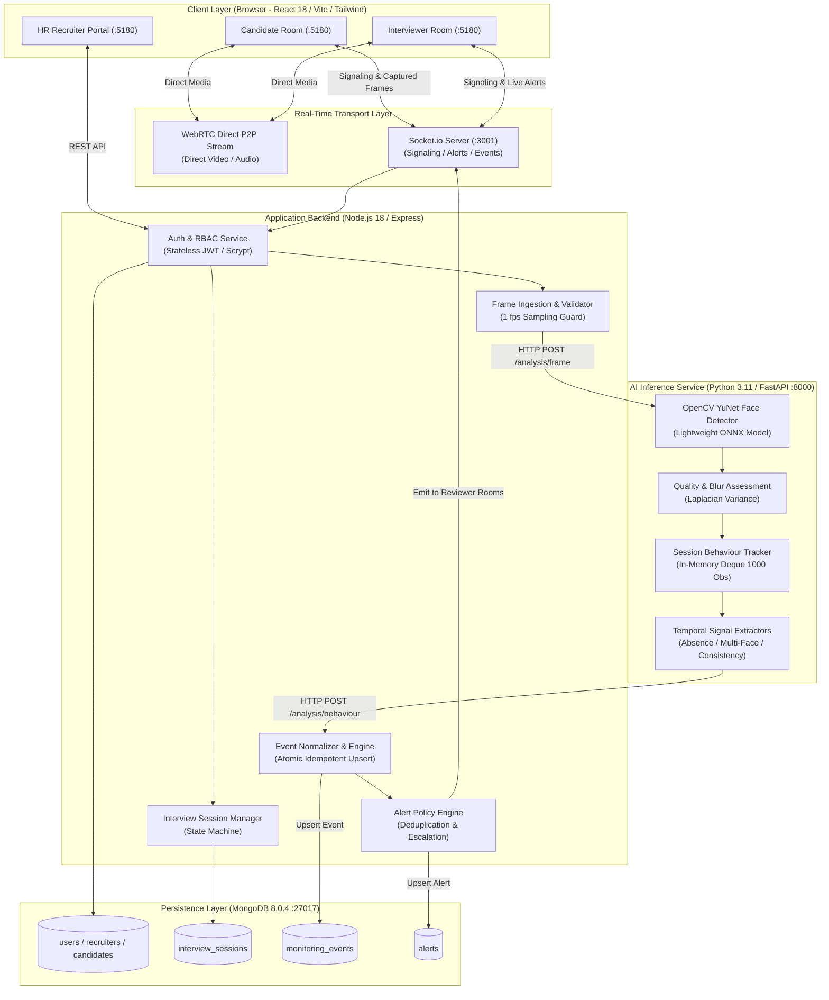
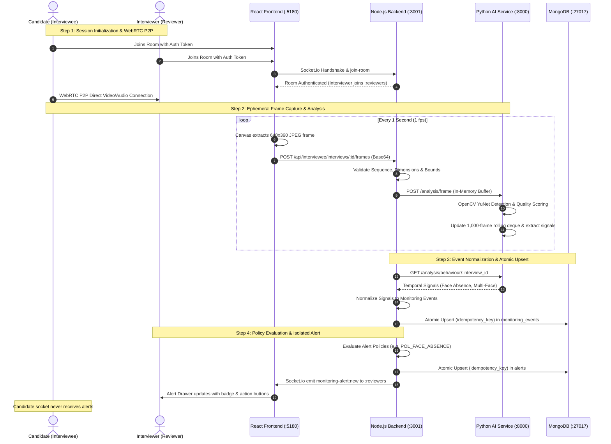

# AI Interview Monitoring and Detection System — AI Interview Integrity Platform

[]()
[]()
[]()
[]()
[]()

> **Enterprise-grade, privacy-first, real-time interview integrity monitoring system.** Provides objective behavioral signal extraction, structured event generation, and synchronized notification dispatch during live remote interviews — engineered strictly for **human-in-the-loop review**, not automated judgment.

---

## Table of Contents

- [1. Project Overview](#1-project-overview)
- [2. Problem Statement](#2-problem-statement)
- [3. Project Objectives](#3-project-objectives)
- [4. Key Features](#4-key-features)
- [5. System Architecture](#5-system-architecture)
- [6. Technology Stack](#6-technology-stack)
- [7. Project Directory Structure](#7-project-directory-structure)
- [8. How the System Works](#8-how-the-system-works)
- [9. Setup & Installation](#9-setup--installation)
  - [Prerequisites](#prerequisites)
  - [Frontend Setup](#frontend-setup)
  - [Backend Setup](#backend-setup)
  - [AI Service Setup](#ai-service-setup)
  - [MongoDB Configuration](#mongodb-configuration)
  - [Environment Variables](#environment-variables)
- [10. Running the Platform](#10-running-the-platform)
  - [Local Development](#local-development)
  - [Docker Setup](#docker-setup)
- [11. Available API Services](#11-available-api-services)
- [12. Testing & Quality Assurance](#12-testing--quality-assurance)
- [13. Current Project Capabilities](#13-current-project-capabilities)
- [14. Privacy, Security & Ethical Design](#14-privacy-security--ethical-design)
- [15. Current Development Status](#15-current-development-status)
- [16. Future Roadmap](#16-future-roadmap)
- [17. Documentation Links](#17-documentation-links)

---

## 1. Project Overview

The **AI Interview Monitoring and Detection System** is an end-to-end platform designed to uphold the integrity of remote technical and professional interviews. By combining WebRTC peer-to-peer audiovisual streaming with local, privacy-preserving computer vision (OpenCV YuNet) and temporal behavioral signal extractors, the platform identifies objective physical presence indicators (e.g., face absence, multiple faces, degraded frame quality) in real time.

All findings are persisted as structured, idempotent monitoring events and evaluated against configurable policies to trigger live alert notifications for HR recruiters and interviewers. The system adheres strictly to a **non-punitive, human-in-the-loop philosophy**: it produces verifiable factual observations to assist human evaluators rather than rendering automated verdicts of cheating or dishonesty.

---

## 2. Problem Statement

Remote hiring has introduced critical integrity challenges for talent acquisition teams:
1. **Rampant Proxy & Collaboration Cheating:** Unauthorized third parties assisting candidates or substituting for them during online evaluations.
2. **Deficiencies in Existing Proctoring Tools:** Legacy proctoring software frequently relies on intrusive, proprietary black-box algorithms, invasive desktop surveillance, or flawed emotion-detection heuristics that falsely penalize neurodivergent individuals or candidates in low-light environments.
3. **Data Privacy & Compliance Risks:** Transmitting sensitive candidate video feeds to third-party proprietary AI cloud APIs violates modern data sovereignty and privacy regulations (such as GDPR).
4. **Lack of Human-Centric Review Context:** Recruiters are often presented with opaque "fraud scores" devoid of timestamped factual evidence or review context.

---

## 3. Project Objectives

- **Deliver High-Fidelity P2P Collaboration:** Low-latency WebRTC video and audio exchange between candidate and interviewer.
- **Ensure Complete Local Privacy:** Execute computer vision inference locally on CPU using open-source models, with **zero raw-frame storage** on disk or database.
- **Provide Objective, Explainable Signals:** Replace opaque fraud scores with factual physical observations (e.g., face presence consistency, multiple face detection).
- **Enforce Strict Role Isolation:** Isolate candidate users from interviewer alerts and monitoring streams; candidate sockets never receive proctoring telemetry.
- **Enable Zero-Cost Development:** Operationalize the MVP on local developer hardware using open-source software without recurring cloud API costs.

---

## 4. Key Features

- 👥 **Multi-Persona Workflows:** Dedicated, customized portals for HR Recruiters, Interviewers, and Candidates (Interviewees).
- 📹 **Native WebRTC Audio/Video:** Direct peer-to-peer media streaming with Google public STUN and automated ICE candidate buffering.
- 🛠️ **Real Hardware System Check:** Automated browser capability verification checking camera, microphone, and network reachability with mandatory entry gating.
- ⚡ **Controlled Webcam Frame Sampling:** Non-blocking 1 fps offscreen canvas sampling with backpressure handling and sequence tracking.
- 🧠 **Local Computer Vision (OpenCV YuNet):** Sub-50ms CPU face detection, bounding-box tracking, lighting assessment, and Laplacian blur grading.
- ⏱️ **Temporal Behaviour Signal Extraction:** Rolling window analysis (capped at 1,000 frames) detecting sustained face absence, multiple faces, and presence consistency ratios.
- 🔄 **Idempotent Event Engine:** Atomic MongoDB upserts (`findOneAndUpdate`) with deterministic keys preventing duplicate event generation on network retries.
- 🔔 **Real-Time Policy Alert Engine:** Configurable priority policies (`HIGH`, `MEDIUM`, `LOW`, `INFO`), alert deduplication, automated escalation sweeps, and live collapsible drawer UI for interviewers.
- 🛡️ **Candidate-Isolated Notification Routing:** Socket.io room segregation ensuring candidates never receive reviewer alerts or integrity metrics.

---

## 5. System Architecture

The platform operates as a cohesive, three-tier multi-service architecture:



---

## 6. Technology Stack

| Layer | Technology | Version | Purpose |
|---|---|---|---|
| **Frontend Framework** | React | 18.3.1 | Component-based reactive user interface |
| **Build Tooling** | Vite | 5.4.8 | High-speed frontend development server and bundling |
| **Styling** | Tailwind CSS | 3.4.13 | Utility-first responsive design system |
| **Language (Frontend)**| TypeScript | 5.5.3 | Static type safety and contract enforcement |
| **Icons & UI** | Lucide React | 0.441.0 | Accessible UI icons |
| **Backend Runtime** | Node.js | 18+ LTS | Asynchronous server execution runtime |
| **Backend Framework** | Express.js | 4.18.2 | RESTful routing and middleware orchestration |
| **Real-Time Engine** | Socket.io | 4.8.1 | Real-time signaling, room management, and alert dispatch |
| **Security & Auth** | Helmet / JWT / Scrypt | 7.1.0 / 9.0.3 | HTTP security headers, stateless JWT, native scrypt hashing |
| **Database** | MongoDB | 8.0.4 | Document-oriented persistence layer |
| **Database Driver** | MongoDB Native Driver | 6.21.0 | High-performance async database client (no heavy ODM) |
| **AI Runtime** | Python | 3.11+ | High-performance mathematical and AI execution |
| **AI Framework** | FastAPI | 0.142.2 | High-throughput async ASGI web microservice |
| **ASGI Server** | Uvicorn | 0.54.0 | ASGI web server implementation |
| **Computer Vision** | OpenCV (Headless) | 4.10.0+ | YuNet ONNX face detection and image metrics |
| **Numerical Processing**| NumPy | 1.26.0+ | Array and tensor manipulation |
| **Validation** | Pydantic / Pydantic Settings | 2.13.5 | Request validation and environment configuration |

---

## 7. Project Directory Structure

```text
ai-interview-monitoring-system/
├── frontend/                     # React 18 + Vite + Tailwind CSS Single-Page Application
│   ├── src/
│   │   ├── components/           # UI components, layout shells, alert drawer
│   │   ├── hooks/                # useAuth, useWebRTC, useWebcamCapture
│   │   ├── lib/                  # Centralized API client (api.ts), socket client (socket.ts)
│   │   ├── pages/                # Public, Auth, HR, Interviewer, Interviewee routes
│   │   ├── App.tsx               # Primary application routing & RBAC guards
│   │   └── main.tsx              # Application entry point
│   ├── package.json              # Frontend dependencies and scripts
│   ├── vite.config.ts            # Vite config (strict port 5180, /socket.io proxy)
│   └── tailwind.config.ts        # Tailwind design tokens
│
├── backend/                      # Node.js 18 + Express Application Backend
│   ├── src/
│   │   ├── alerts/               # Alert engine, policy service, deduplicator, escalation
│   │   ├── auth/                 # Password hashing (scrypt), tokens (JWT), RBAC middleware
│   │   ├── config/               # Database connection lifecycle
│   │   ├── db/                   # Collections, constants, indexes, persistence layer
│   │   ├── events/               # Event normalizer, event engine, event repository
│   │   ├── middleware/           # Centralized error handler, request logger
│   │   ├── monitoring/           # Frame validation service, in-memory tracker
│   │   ├── routes/               # REST routers (auth, interviews, alerts, events)
│   │   ├── services/             # AI service HTTP client
│   │   ├── socket/               # Socket.io signaling server & recipient isolation
│   │   └── app.js                # Express application configuration
│   ├── tests/                    # 82 automated test suites (298 tests)
│   ├── server.js                 # HTTP server entry point & graceful shutdown
│   ├── package.json              # Backend dependencies and test scripts
│   └── .env.example              # Environment variable template
│
├── ai-service/                   # Python 3.11 + FastAPI Computer Vision Microservice
│   ├── app/
│   │   ├── core/                 # Config (pydantic-settings), logging
│   │   ├── models/               # OpenCV YuNet ONNX face detector weights
│   │   ├── routes/               # Health, computer vision, and behaviour endpoints
│   │   ├── schemas/              # Pydantic schemas (CVAnalysisResult, BehaviourResult)
│   │   ├── services/             # Frame preprocessor, CV engine, behaviour extractors
│   │   └── main.py               # FastAPI application factory & lifespan
│   ├── tests/                    # Pytest test suites (123 tests)
│   ├── requirements.txt          # Pinned Python dependencies
│   └── .env.example              # AI service environment template
│
├── docs/                         # Official Product & Architectural Specifications
│   ├── 01-PRD.md                 # Product Requirements Document v1.0
│   ├── 02-SRS.md                 # Software Requirements Specification v1.0
│   ├── 03-System-Architecture.md # System Architecture v1.0
│   ├── 04-Database-Specification.md # Database Specification v1.0
│   ├── 05-AI-ML-Specification.md # AI/ML Specification v1.0
│   ├── 06-UI-UX-Specification.md # UI/UX Specification v1.0
│   ├── 07-Development-Plan.md    # Development Plan v1.0
│   ├── 08-Testing-Evaluation.md  # Testing & Evaluation Plan v1.0
│   ├── 09-Infrastructure-Plan.md # Zero-Cost Infrastructure Plan v1.0
│   └── 10-Startup-Product-Roadmap.md # Startup & Product Roadmap v1.0
│
├── scripts/                      # Utility scripts (seed demo accounts, migrations)
├── docker-compose.yml            # Multi-service container specification
├── CLAUDE.md                     # Engineering guidelines & product boundaries
├── IMPLEMENTATION_PLAN.md        # 24-Phase dependency-driven development roadmap
├── DECISION_LOG.md               # Authoritative decision record (DEC-001 through DEC-038)
├── PROJECT_STATUS.md             # Detailed engineering verification status
├── README_REPORT.md              # Comprehensive master report for Phases 1–16
└── README.md                     # Primary repository entry point (this document)
```

---

## 8. How the System Works

The end-to-end operational flow follows a disciplined lifecycle:



---

## 9. Setup & Installation

### Prerequisites

- **Node.js:** v18.0.0 or higher
- **npm:** v9.0.0 or higher
- **Python:** v3.11.0 or higher
- **MongoDB:** v7.0.0 or v8.0.0+ Community Server
- **Git:** Version control

---

### Frontend Setup

```bash
cd frontend
npm install
cp .env.example .env
```

Ensure `frontend/.env` contains:
```env
VITE_API_BASE_URL=http://localhost:3001
```

---

### Backend Setup

```bash
cd backend
npm install
cp .env.example .env
```

Configure `backend/.env`:
```env
NODE_ENV=development
PORT=3001
ALLOWED_ORIGINS=http://localhost:5173,http://localhost:5180
MONGODB_URI=mongodb://127.0.0.1:27017
MONGODB_DB_NAME=interview_monitoring
JWT_SECRET=your-secure-development-jwt-secret-minimum-32-chars
JWT_EXPIRES_IN=24h
AI_SERVICE_URL=http://127.0.0.1:8000
```

---

### AI Service Setup

```bash
cd ai-service
python3 -m venv venv
source venv/bin/activate
pip install -r requirements.txt
cp .env.example .env
```

Verify that `ai-service/app/models/face_detection_yunet_2023mar.onnx` is present.

---

### MongoDB Configuration

Ensure MongoDB is installed and listening on `127.0.0.1:27017`:

```bash
# macOS (Homebrew)
brew services start mongodb-community@8.0

# Linux (systemd)
sudo systemctl start mongod
```

Baseline indexes are created automatically by the backend upon server startup.

---

## 10. Running the Platform

### Local Development

For local development, execute each service in a separate terminal:

```bash
# Terminal 1: MongoDB Daemon (if not running as a service)
mongod --dbpath /path/to/data

# Terminal 2: Python AI Service (Port 8000)
cd ai-service
source venv/bin/activate
uvicorn app.main:app --host 0.0.0.0 --port 8000 --reload

# Terminal 3: Node.js Backend (Port 3001)
cd backend
npm run dev

# Terminal 4: Frontend Development Server (Port 5180)
cd frontend
npm run dev
```

Once running, access the portals at:
- **Frontend Web UI:** `http://localhost:5180`
- **Backend API:** `http://localhost:3001/api`
- **Backend Health Check:** `http://localhost:3001/health`
- **AI Service OpenAPI Docs:** `http://localhost:8000/docs`

---

### Docker Setup

To build and execute all services in containerized mode:

```bash
# Build and run containers in detached mode
docker-compose up --build -d

# View consolidated logs
docker-compose logs -f
```

---

## 11. Available API Services

### Application Backend Endpoints (`http://localhost:3001`)

| Method | Endpoint | Access | Purpose |
|---|---|---|---|
| `GET` | `/health` | Public | Backend liveness probe |
| `GET` | `/ready` | Public | Database readiness verification |
| `POST`| `/api/auth/register` | Public | Register new user (HR, Interviewer, Interviewee) |
| `POST`| `/api/auth/login` | Public | Authenticate user & return stateless JWT |
| `POST`| `/api/auth/logout` | Authenticated | Terminate client authentication session |
| `GET` | `/api/auth/me` | Authenticated | Retrieve authenticated user profile |
| `POST`| `/api/interviews` | HR Only | Create new interview session |
| `GET` | `/api/interviews` | HR Only | List interviews owned by authenticated HR |
| `GET` | `/api/interviews/:id` | HR Only | Retrieve owned interview detail |
| `PATCH`| `/api/interviews/:id`| HR Only | Update interview title or schedule |
| `POST`| `/api/interviews/:id/invite` | HR Only | Transition session to `invited` & issue token |
| `POST`| `/api/interviews/:id/assign` | HR Only | Assign active interviewer to session |
| `GET` | `/api/interviewer/interviews` | Interviewer | List sessions assigned to authenticated interviewer |
| `GET` | `/api/interviewer/interviews/:id/room` | Interviewer | Access authorized interviewer room context |
| `GET` | `/api/interviewee/interviews` | Candidate | List candidate's assigned interviews |
| `GET` | `/api/interviewee/interviews/:id/room` | Candidate | Access authorized candidate room context |
| `POST`| `/api/interviewee/interviews/:id/frames` | Candidate | Ingest sampled webcam frame (1 fps) |
| `GET` | `/api/interviews/:id/monitoring-events` | Reviewers | List paginated monitoring events |
| `GET` | `/api/interviews/:id/alerts` | Reviewers | List alerts for interview session |
| `PATCH`| `/api/alerts/:alertId/acknowledge` | Reviewers | Acknowledge alert and halt escalation |
| `PATCH`| `/api/alerts/:alertId/dismiss` | Reviewers | Dismiss alert record |

### AI Inference Service Endpoints (`http://localhost:8000`)

| Method | Endpoint | Access | Purpose |
|---|---|---|---|
| `GET` | `/health` | Internal | AI service liveness probe |
| `GET` | `/ready` | Internal | AI service component readiness probe |
| `POST`| `/analysis/frame` | Internal | Execute OpenCV YuNet face detection & quality analysis |
| `POST`| `/analysis/behaviour` | Internal | Ingest observation and extract temporal behavioral signals |
| `GET` | `/analysis/behaviour/{interview_id}` | Internal | Retrieve current session behavioral signals |
| `DELETE`| `/analysis/behaviour/{interview_id}` | Internal | Flush in-memory session tracking buffer |

---

## 12. Testing & Quality Assurance

The codebase enforces strict test-driven non-regression guarantees:

### Running Backend Tests (Node.js Native Test Runner)
```bash
cd backend
npm test
```
*Current Result:* **298/298 passed** across 82 test suites (0 failures).

### Running AI Service Tests (Pytest)
```bash
cd ai-service
source venv/bin/activate
pytest tests/ -v
```
*Current Result:* **123/123 passed** (0 failures).

### Running Frontend Type-Check & Linter
```bash
cd frontend
npm run build   # Executes `tsc -b && vite build`
npm run lint    # Executes ESLint 9 flat config
```
*Current Result:* **0 TypeScript errors, 0 ESLint errors**.

---

## 13. Current Project Capabilities

As of **Phase 16 (Real-Time Alerts)**, the platform fully supports:
1. **End-to-End Interview Scheduling:** HR recruiters can register, create interviews, assign interviewers, and generate secure invitation tokens.
2. **Real Hardware Readiness Gating:** Candidates can verify webcam, microphone, and internet connectivity before entering the interview room.
3. **Live P2P WebRTC Sessions:** Real-time mutual audiovisual communication between candidate and interviewer with in-room mute/video toggles.
4. **Controlled In-Memory CV Sampling:** 1 fps client-side frame sampling, OpenCV YuNet face detection, and image quality assessment with **zero disk storage**.
5. **Temporal Signal Generation:** Moving-window analysis detecting face absence, presence of multiple individuals, and sampling consistency.
6. **Structured Event Persistence:** Idempotent normalization of signals into `monitoring_events` in MongoDB.
7. **Real-Time Isolated Alert Notifications:** Reviewers receive live alerts via Socket.io with an in-room Alert Drawer, while candidate sockets remain strictly isolated.

---

## 14. Privacy, Security & Ethical Design

- **Zero Raw-Frame Persistence (DEC-012, DEC-015):** Webcam frames are processed ephemerally in RAM and immediately dereferenced. No raw images are saved to disk or database.
- **Candidate Data Redaction:** Interviewer views join candidate names but omit candidate email addresses to minimize unnecessary PII exposure.
- **Strict Recipient Isolation:** Reviewer rooms (`interview:${id}:reviewers`) receive real-time alerts. Candidates are barred from joining reviewer rooms and receive zero alert telemetry.
- **Neutral, Objective Terminology:** The entire platform bans subjective, accusatory terms such as *"cheating"*, *"fraud"*, *"guilty"*, or *"suspicious"*. It strictly uses objective descriptions like *"No face observed across 5s interval"*.
- **Human-in-the-Loop Authority:** The AI service never disqualifies a candidate or terminates a session. It solely surfaces factual context for human recruiters.

---

## 15. Current Development Status

The project is executed across a **24-Phase Implementation Plan**:

```text
[X] Phase 1  — Requirements Freeze & Repository Setup
[X] Phase 2  — Frontend Foundation & Stabilization
[X] Phase 3  — Node/Express Backend Foundation
[X] Phase 4  — Python/FastAPI AI Service Foundation
[X] Phase 5  — MongoDB Persistence Foundation
[X] Phase 6  — Authentication & Role-Based Access Control
[X] Phase 7  — HR Product & Interview Lifecycle
[X] Phase 8  — Interviewer Product & Assignment Workflows
[X] Phase 9  — Candidate Product & Hardware System Check
[X] Phase 10 — Interview Room & Session State Machine
[X] Phase 11 — WebRTC & Socket.io Real-Time Signaling
[X] Phase 12 — Controlled Webcam Capture & Frame Ingestion
[X] Phase 13 — Computer Vision (OpenCV YuNet Face Detection)
[X] Phase 14 — Observable Behaviour Signal Extraction
[X] Phase 15 — Event Engine & Persistence
[X] Phase 16 — Real-Time Alerts & Notification Engine
[ ] Phase 17 — Evidence System (NEXT)
[ ] Phase 18 — Live Monitoring & Basic Integrity View
[ ] Phase 19 — Interview Report (PDF & Web)
[ ] Phase 20 — End-to-End MVP Integration Testing
[ ] Phase 21 — Controlled AI Evaluation & Benchmarking
[ ] Phase 22 — Internal Validation & Pilot Program
[ ] Phase 23 — V2 Multimodal Integrity Intelligence
[ ] Phase 24 — SaaS Productization & Enterprise Scale
```

---

## 16. Future Roadmap

- **Phase 17 (Evidence System):** Implementation of keyframe capture and encrypted thumbnail retention for verified monitoring events.
- **Phase 18 (Live Monitoring & Integrity View):** Unified live monitoring dashboard for HR evaluators displaying multi-candidate session health and event chronologies.
- **Phase 19 (Interview Report):** Automated generation of comprehensive post-interview integrity reports, reviewer audit logs, and exportable PDF summaries.
- **Phases 20–24 (Enterprise Evolution):** Rigorous controlled evaluation, audio speech-to-text integration, multi-sensor behavioral fusion, and enterprise ATS connectors.

---

## 17. Documentation Links

- **[Master Development Report (Phases 1–16)](./README_REPORT.md)** — Exhaustive historical report detailing every phase's technical implementation, database changes, and test results.
- **[Decision Log](./DECISION_LOG.md)** — Complete record of architectural decisions (DEC-001 through DEC-038).
- **[Project Status](./PROJECT_STATUS.md)** — Granular verification matrices and operational environment notes.
- **[Implementation Plan](./IMPLEMENTATION_PLAN.md)** — Full 24-phase dependency roadmap.
- **[System Architecture](./docs/03-System-Architecture.md)** — Comprehensive architecture design document.
- **[Database Specification](./docs/04-Database-Specification.md)** — Detailed collections, schemas, and indexing strategy.
- **[AI/ML Specification](./docs/05-AI-ML-Specification.md)** — Computer vision and signal extraction specifications.

---

## License

Proprietary — All rights reserved. Built with modern, privacy-first software engineering standards.
# ASIP_003
