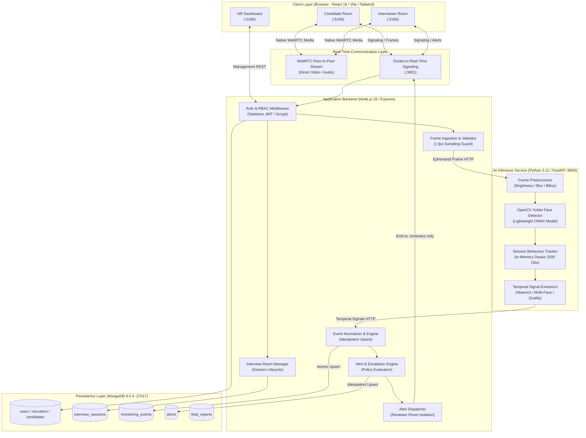
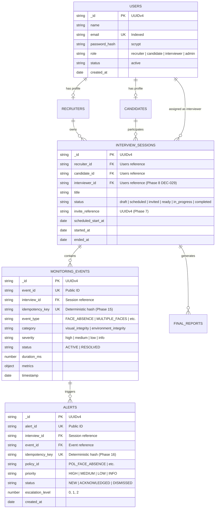

# AI Interview Monitoring and Detection System — Comprehensive Development & Phase Report (Phases 1–16)

**Project Framing:** AI Interview Integrity Platform  
**System Status:** Phases 1–16 COMPLETE | Phase 17 (Evidence System) NEXT  
**Document Classification:** Master Technical Report & Architectural Evolution  
**Date of Completion:** November 2026  

---

## Table of Contents

1. [Section 1: Project Development Overview](#section-1-project-development-overview)
2. [Section 2: Phase-wise Development History (Phases 1 to 16)](#section-2-phase-wise-development-history-phases-1-to-16)
   - [Phase 1: Requirements Freeze & Repository Setup](#phase-1--requirements-freeze--repository-setup)
   - [Phase 2: Frontend Foundation & Stabilization](#phase-2--frontend-foundation--stabilization)
   - [Phase 3: Node.js / Express Backend Foundation](#phase-3--nodejs--express-backend-foundation)
   - [Phase 4: Python / FastAPI AI Service Foundation](#phase-4--python--fastapi-ai-service-foundation)
   - [Phase 5: MongoDB Persistence Foundation & Schema Baseline](#phase-5--mongodb-persistence-foundation--schema-baseline)
   - [Phase 6: Authentication & Role-Based Access Control (RBAC)](#phase-6--authentication--role-based-access-control-rbac)
   - [Phase 7: HR Product & Interview Management Lifecycle](#phase-7--hr-product--interview-management-lifecycle)
   - [Phase 8: Interviewer Product & Assignment Workflows](#phase-8--interviewer-product--assignment-workflows)
   - [Phase 9: Candidate Product, Neutral Disclosure & Hardware System Check](#phase-9--candidate-product-neutral-disclosure--hardware-system-check)
   - [Phase 10: Interview Room & Session State Machine](#phase-10--interview-room--session-state-machine)
   - [Phase 11: WebRTC & Socket.io Real-Time Signaling](#phase-11--webrtc--socketio-real-time-signaling)
   - [Phase 12: Controlled Webcam Capture & Frame Ingestion](#phase-12--controlled-webcam-capture--frame-ingestion)
   - [Phase 13: Computer Vision Inference Engine (YuNet Face Detection)](#phase-13--computer-vision-inference-engine-yunet-face-detection)
   - [Phase 14: Observable Behaviour Signal Extraction](#phase-14--observable-behaviour-signal-extraction)
   - [Phase 15: Event Engine & Persistence](#phase-15--event-engine--persistence)
   - [Phase 16: Real-Time Alerts & Notification Engine](#phase-16--real-time-alerts--notification-engine)
3. [Section 3: Overall Technical Architecture](#section-3-overall-technical-architecture)
4. [Section 4: Database Evolution](#section-4-database-evolution)
5. [Section 5: Testing & Quality Assurance Summary](#section-5-testing--quality-assurance-summary)
6. [Section 6: Important Technical Decisions (Decision Log Summary)](#section-6-important-technical-decisions-decision-log-summary)
7. [Section 7: Security, Privacy & Ethical Considerations](#section-7-security-privacy--ethical-considerations)
8. [Section 8: Current Project Status](#section-8-current-project-status)
9. [Section 9: Upcoming Development Roadmap](#section-9-upcoming-development-roadmap)

---

# Section 1: Project Development Overview

The **AI Interview Monitoring and Detection System** (branded as the **AI Interview Integrity Platform**) is an enterprise-grade, multi-service platform engineered to provide real-time integrity monitoring, objective behavioral signal extraction, structured event generation, and synchronized notification dispatch during live remote interviews.

### Core Engineering Philosophy & Principles

1. **Human-in-the-Loop Integrity Review (DEC-001, DEC-002):**  
   The platform is explicitly designed **not** as an automated, punitive cheat-detection judge. It produces objective, timestamped observations, statistical temporal signals, structured events, and real-time alerts strictly to provide human recruiters and interviewers with verifiable factual context. Definitiveness and intent inferences (e.g., "guilty", "dishonest", "cheating") are strictly banned across the entire codebase, database models, schemas, and user interfaces.
2. **Logical Modular Separation Without Premature Complexity (DEC-003, DEC-004):**  
   The system utilizes a clean three-tier multi-service architecture:
   - **Frontend:** Single-page application built with React 18, Vite, TypeScript, and Tailwind CSS.
   - **Application Backend:** Node.js 18+ and Express.js coordinating business logic, authentication, interview lifecycle, Socket.io signaling, event normalization, and persistence.
   - **AI Service:** Python 3.11+ and FastAPI powering computer vision (CV) face detection and sliding-window temporal behavioral analysis.
   - **Database:** MongoDB 8.0+ storing strictly structured metadata, users, interview records, events, alerts, and reports.
3. **Data Minimization & Zero Permanent Raw-Frame Storage (DEC-006, DEC-012, DEC-015):**  
   Raw webcam video frames transmitted from the browser are processed ephemerally in-memory by the AI inference engine. Raw frames are never written to disk, never persisted into MongoDB documents, and never output in application logs.
4. **Backend Authorization as the Sole Security Boundary (DEC-011):**  
   Client-side route guards and navigation menus are treated purely as UI/UX ergonomics. True security, multi-role isolation, and resource ownership (e.g., candidate profile verification, interviewer assignment checks, HR ownership) are strictly enforced at the Node.js backend layer on every HTTP request and Socket.io signaling event.
5. **Deterministic Idempotency and Non-Regression Testing:**  
   Every event and alert generation pipeline incorporates deterministic idempotency keys backed by unique sparse MongoDB indexes to guarantee zero document duplication during stream retries or parallel frame processing. Automated test suites enforce total non-regression before every phase gate.

---

# Section 2: Phase-wise Development History (Phases 1 to 16)

---

### Phase 1 — Requirements Freeze & Repository Setup

- **Phase Objective:** Establish project baseline, freeze functional and non-functional requirements, set up repository directory structure, configure version control, and define development discipline.
- **Implementation Details:**
  - Initialized repository structure with top-level directories: `frontend/`, `backend/`, `ai-service/`, `tests/`, `scripts/`, `docs/`.
  - Authored ten foundational specification documents under `docs/` (`01-PRD.md` through `10-Startup-Product-Roadmap.md`).
  - Configured root `.gitignore`, `docker-compose.yml`, `CLAUDE.md`, `IMPLEMENTATION_PLAN.md`, `PROJECT_STATUS.md`, and `DECISION_LOG.md`.
- **Key Features Introduced:** Traceability baseline, phase-gate enforcement protocol, project-control guidelines.
- **Backend / Frontend / DB / AI Changes:** Baseline directory structures and empty application manifests established.
- **Security & Privacy:** Enforced rule prohibiting hardcoded secrets in repository files; initialized `.env.example` templates.
- **Testing & Verification:** Verified repository layout, markdown link integrity, and container configuration templates.
- **Technical Decisions:** Established baseline decisions DEC-001 through DEC-011.
- **Final Status:** COMPLETE.

---

### Phase 2 — Frontend Foundation & Stabilization

- **Phase Objective:** Implement React 18 single-page application shell with Vite, TypeScript, Tailwind CSS, role-based layouts, centralized API client, reusable UI primitives, and establish type safety.
- **Implementation Details:**
  - Configured Vite with strict port binding on `5180` (`strictPort: true`).
  - Implemented multi-layout routing: `PublicLayout`, `AuthLayout`, `HRLayout`, `InterviewerLayout`, and `IntervieweeLayout`.
  - Built comprehensive reusable UI library: `Button`, `Input`, `Card`, `Badge`, `Avatar`, `Dropdown`, `Modal`, `DataTable`, `Table` primitives, `Toast`, `Progress`, `Select`, `Toggle`, `Separator`, `Tabs`, and `Pagination`.
  - Established `src/lib/api.ts` with base URL configuration (`VITE_API_BASE_URL`).
  - **Stabilization & Type Remediation (2026-10-03):** Fixed initial 396+ TypeScript errors down to 0; eliminated duplicate `<BrowserRouter>` wrapping; introduced typed environment definitions in `vite-env.d.ts`; configured ESLint 9 flat config (`eslint.config.js`).
- **Key Features Introduced:** Responsive layouts across 5 product personas, interactive toast system, theme support, design system primitives.
- **Backend / DB / AI Changes:** None (frontend isolated).
- **Security & Privacy:** Ensured zero secrets or private keys in client source; environment-driven backend endpoints.
- **Testing & Verification:**
  - `tsc -b && vite build`: **0 errors** (production build passing).
  - ESLint: **0 errors** (244 non-blocking warnings).
  - Verified local dev server on port `5180`.
- **Technical Decisions:** DEC-012, DEC-013, DEC-017.
- **Final Status:** COMPLETE / STABILIZED.

---

### Phase 3 — Node.js / Express Backend Foundation

- **Phase Objective:** Establish modular Node.js/Express backend foundation with robust error handling, security headers, logging, health check probes, and test scaffolding.
- **Implementation Details:**
  - Created modular entry points: `server.js` (HTTP server lifecycle and graceful shutdown) and `src/app.js` (Express application configuration).
  - Configured security headers using `helmet` and Cross-Origin Resource Sharing (`cors`) allowing local frontend origins (`http://localhost:5173`, `http://localhost:5180`) and pinned e2b preview domains.
  - Built centralized error handling middleware (`src/middleware/errorHandler.js`) featuring `AppError`, `notFoundHandler`, `asyncHandler`, and environment-isolated stack traces.
  - Implemented request logging via `morgan`.
- **Key Features Introduced:** `GET /health` liveness probe, `GET /api` root route, centralized JSON error format (`status`, `statusCode`, `message`, `timestamp`).
- **Backend Changes:** 9 files created (~1,135 lines of code and documentation).
- **Security & Privacy:** Disabled `X-Powered-By`; Helmet headers configured; CORS origin validation; graceful termination handlers (SIGTERM, SIGINT) with 10-second forced shutdown timeout.
- **Testing & Verification:**
  - Built-in Node.js native test runner: **6/6 tests passed** (`backend/tests/app.test.js`).
  - Verified `/health` returned HTTP 200 with service metadata.
- **Technical Decisions:** DEC-014, DEC-016.
- **Final Status:** COMPLETE.

---

### Phase 4 — Python / FastAPI AI Service Foundation

- **Phase Objective:** Construct high-performance Python/FastAPI microservice foundation for AI inference, complete with pydantic settings, lifespan management, health/readiness probes, and OpenAPI documentation.
- **Implementation Details:**
  - Built FastAPI application factory (`ai-service/app/main.py`) with structured lifespan logging for cold-start and termination events.
  - Implemented centralized environment configuration via `pydantic-settings` (`app/core/config.py`).
  - Added structured application logging (`app/core/logging.py`) preventing sensitive data leakage.
  - Established modular extension point directory `app/services/analysis/` for future CV and signal engines.
- **Key Features Introduced:**
  - `GET /health`: Liveness probe reporting process status.
  - `GET /ready`: Readiness probe declaring operational API status.
  - Interactive OpenAPI/Swagger documentation at `/docs` and `/redoc`.
- **Backend / Frontend / DB Changes:** Negative scope guards asserted no database drivers or CV packages loaded prematurely.
- **Security & Privacy:** Server binds strictly to internal network; sensitive variables masked in logs; no model claims made before actual implementation.
- **Testing & Verification:**
  - Pytest test suite: **24/24 tests passed** (`ai-service/tests/test_app.py`, `test_config.py`, `test_health.py`).
  - Verified clean cold start on internal port `8000`.
- **Technical Decisions:** DEC-018, DEC-019.
- **Final Status:** COMPLETE.

---

### Phase 5 — MongoDB Persistence Foundation & Schema Baseline

- **Phase Objective:** Implement MongoDB database connectivity lifecycle, configure connection pooling, establish the 9 core database collections, define baseline schema constraints, and build 19 performance indexes.
- **Implementation Details:**
  - Installed official Node.js MongoDB driver (`mongodb@^6.21.0`) avoiding heavy, inflexible ODMs.
  - Created `backend/src/config/database.js` managing idempotent connection initialization, sanitized logging, and graceful disconnection.
  - Implemented `backend/src/db/collections.js` defining 9 core collections:
    `users`, `recruiters`, `candidates`, `interview_sessions`, `monitoring_events`, `ai_analysis_results`, `alerts`, `evidence`, `final_reports`.
  - Implemented `backend/src/db/indexes.js` creating 19 baseline indexes across all collections.
  - Implemented `backend/src/db/persistence.js` providing data access primitives with strict foreign reference validation (DB-VAL-001..008).
  - Added `GET /ready` probe to Express backend reporting database connection health.
- **Key Features Introduced:** MongoDB connection pooling, automatic index verification on startup, UUIDv4 string identifiers as `_id`.
- **Database Schema Changes:** Established schemas for all 9 collections; created 19 primary and compound indexes.
- **Security & Privacy:** Connection strings isolated in untracked `.env`; connection failures handled gracefully without service crashes; sanitized error logs.
- **Testing & Verification:**
  - Backend test suite: **43/43 tests passed** (including 28 dedicated persistence tests in `backend/tests/database.test.js`).
  - Dedicated `interview_monitoring_test` database with guarded teardown.
- **Technical Decisions:** DEC-020, DEC-021, DEC-022, DEC-023.
- **Final Status:** COMPLETE.

---

### Phase 6 — Authentication & Role-Based Access Control (RBAC)

- **Phase Objective:** Implement stateless JWT authentication, cryptographic password hashing, role-based route protection, resource-level authorization boundaries, and frontend authentication integration.
- **Implementation Details:**
  - Password Hashing (`backend/src/auth/password.js`): Implemented scrypt hashing via Node.js native `crypto.scrypt` (16-byte cryptographically secure salt, 64-byte key length, `timingSafeEqual` comparison, stored as `scrypt$<salt>$<hash>`).
  - Token Management (`backend/src/auth/tokens.js`): Stateless HS256 JWT sign/verify using `jsonwebtoken`, carrying user identifier `sub` and resolving user/role dynamically on each request.
  - Role Mapping (`backend/src/auth/roles.js`): Mapped internal SRS database roles (`recruiter`, `candidate`, `interviewer`, `admin`) to public UI product personas (`hr`, `interviewee`, `interviewer`).
  - Middleware (`backend/src/auth/middleware.js`): Built `authenticate` (enforces valid Bearer JWT) and `authorize(...roles)` (enforces role membership).
  - Resource Access (`backend/src/auth/resourceAccess.js`): Implemented interview ownership checking (`authorizeInterviewAccess`).
  - Routes (`backend/src/routes/auth.js`): `POST /api/auth/register`, `POST /api/auth/login`, `POST /api/auth/logout`, `GET /api/auth/me`.
  - Frontend Auth: Updated `useAuth.tsx` to communicate with real backend endpoints; updated `SignInPage.tsx` and `SignUpPage.tsx`.
- **Key Features Introduced:** Real user registration and login, password verification, session restoration via `/api/auth/me`, deterministic logout.
- **Backend / Database Changes:** User records persisted in `users` collection with unique index on `email`; linked `recruiters` and `candidates` profile generation.
- **Security & Privacy:** Zero plaintext passwords stored or logged; password hashes excluded from all API responses (`toSafeUser`); distinction maintained between 401 Unauthorized and 403 Forbidden.
- **Testing & Verification:**
  - Backend test suite: **105/105 tests passed** (62 new tests in `backend/tests/auth.test.js` and `auth-rbac.test.js`).
  - Verified role rejection matrix across all endpoints.
- **Technical Decisions:** DEC-024, DEC-025, DEC-026, DEC-027, DEC-028.
- **Final Status:** COMPLETE.

---

### Phase 7 — HR Product & Interview Management Lifecycle

- **Phase Objective:** Implement complete HR recruiter capabilities for interview session creation, candidate selection, interview scheduling, lifecycle state progression (`draft` → `invited`), and HR dashboard interfaces.
- **Implementation Details:**
  - Backend Endpoints (`backend/src/routes/interviews.js`):
    - `POST /api/interviews`: Creates interview session associated with authenticated recruiter.
    - `GET /api/interviews`: Lists all interviews owned by the requesting HR user.
    - `GET /api/interviews/:id`: Retrieves specific interview detail with candidate display data.
    - `PATCH /api/interviews/:id`: Modifies interview title and scheduled start time.
    - `POST /api/interviews/:id/invite`: Triggers invitation workflow, transitioning session to `invited` and generating opaque UUID `invite_reference`.
    - `GET /api/candidates`: Lists eligible registered candidates with sanitized fields.
  - Frontend Pages: Rewrote `DashboardPage.tsx`, `InterviewsPage.tsx`, `CandidatesPage.tsx`, and introduced `CreateInterviewPage.tsx` and `InterviewDetailPage.tsx` using live backend data.
- **Key Features Introduced:** Real interview CRUD, candidate selection picker, invitation token generator, status badges, metric counters.
- **Database Changes:** `interview_sessions` collection actively populated with recruiter association (`recruiter_id`) and status tracking.
- **Security & Privacy:** Enforced recruiter ownership checks on every mutation; prevented cross-HR interview modification; sanitized candidate user fields.
- **Testing & Verification:**
  - Backend test suite: **145/145 tests passed** (40 new tests in `backend/tests/interviews.test.js`).
  - Frontend build and lint passing with 0 errors.
- **Technical Decisions:** DEC-029 (baseline preparation).
- **Final Status:** COMPLETE.

---

### Phase 8 — Interviewer Product & Assignment Workflows

- **Phase Objective:** Implement interviewer workflow, HR interviewer assignment, assigned-interview listings, and permitted report view access.
- **Implementation Details:**
  - Schema Approval (DEC-029): Added scalar `interviewer_id` field to `interview_sessions` and created sparse index `idx_int_005_interviewer_status_created`.
  - Backend Endpoints (`backend/src/routes/interviewer.js`):
    - `POST /api/interviews/:id/assign`: Allows owning HR user to assign an active interviewer.
    - `GET /api/interviewers`: Lists active interviewer accounts for HR selection.
    - `GET /api/interviewer/interviews`: Returns only sessions assigned to authenticated interviewer.
    - `GET /api/interviewer/interviews/:id`: Returns assigned interview detail (with candidate name; candidate email withheld).
    - `GET /api/interviewer/interviews/:id/report`: Provides authorized report access (returns truthful 404 until generated in Phase 19).
  - Frontend Pages: Rewrote interviewer `DashboardPage.tsx`, `InterviewsPage.tsx`, and created `InterviewDetailPage.tsx`. Added assign modal to HR views.
- **Key Features Introduced:** Interviewer assignment workflow, assigned interview schedule tracking, truthful session state communication.
- **Database Changes:** Added `interviewer_id` field to `interview_sessions` with compound index on `{ interviewer_id: 1, status: 1, created_at: -1 }`.
- **Security & Privacy:** Candidate email strictly withheld from interviewer views; interviewer authorization enforced via `authorizeInterviewAccess`.
- **Testing & Verification:**
  - Backend test suite: **177/177 tests passed** (32 new tests in `backend/tests/interviewer.test.js`).
  - Verified cross-interviewer data isolation.
- **Technical Decisions:** DEC-029.
- **Final Status:** COMPLETE.

---

### Phase 9 — Candidate Product, Neutral Disclosure & Hardware System Check

- **Phase Objective:** Implement candidate product workflows, candidate dashboard, assigned interview access, neutral monitoring disclosure, and a real hardware system readiness check.
- **Implementation Details:**
  - Backend Endpoints (`backend/src/routes/interviewee.js`):
    - `GET /api/interviewee/interviews`: Returns candidate's own assigned interviews.
    - `GET /api/interviewee/interviews/:id`: Returns candidate's authorized interview detail.
  - Frontend Screens: Rewrote candidate `DashboardPage.tsx`, `InterviewsPage.tsx`, `HistoryPage.tsx`, and introduced `InterviewDetailPage.tsx`.
  - **Hardware System Check (`SystemCheckPage.tsx`):** Engineered real browser device probing using `navigator.mediaDevices.getUserMedia`:
    - **Camera:** Mandatory video track acquisition; verified readiness state; stopped tracks immediately without recording.
    - **Microphone:** Audio capability acquisition; verified input.
    - **Connectivity:** Factual network reachability via `navigator.onLine`.
    - **Browser APIs:** Verified `getUserMedia` and `RTCPeerConnection` support.
    - **Mandatory Gating:** "Continue" button strictly disabled until mandatory checks pass.
  - **Neutral Monitoring Disclosure:** Transparent explanation of observable behavioral monitoring in non-punitive, factual terms.
- **Key Features Introduced:** Candidate self-service dashboard, hardware readiness verification, camera/mic permission flow, transparent monitoring disclosure.
- **Database Changes:** None (hardware check results maintained client-side to prevent unverified persistence).
- **Security & Privacy:** Camera and mic streams stopped immediately upon check completion; client identity enforced via session token.
- **Testing & Verification:**
  - Backend test suite: **192/192 tests passed** (15 new tests in `backend/tests/interviewee.test.js`).
  - Verified camera permission rejection handling and UI recovery flows.
- **Technical Decisions:** DEC-030.
- **Final Status:** COMPLETE.

---

### Phase 10 — Interview Room & Session State Machine

- **Phase Objective:** Construct controlled interview room foundation, mutual participant join/leave workflows, and session lifecycle state machine (`in_progress` → `completed`).
- **Implementation Details:**
  - Backend Lifecycle Services (`backend/src/db/persistence.js`):
    - `startInterviewSession`: Transitions enterable session to `in_progress` and records `started_at`.
    - `completeInterviewSession`: Transitions active session to `completed` and records `ended_at`.
    - `getInterviewRoomContext`: Fetches session context with privacy-scoped participant data.
  - Backend Endpoints:
    - Candidate: `GET /room`, `POST /room/join`, `POST /room/leave`.
    - Interviewer: `GET /room`, `POST /room/join`, `POST /room/end`.
  - Frontend Room Pages:
    - `IntervieweeInterviewRoomPage.tsx`: Candidate room layout with self-view tile, peer tile, session timer, and exit controls.
    - `InterviewerInterviewRoomPage.tsx`: Interviewer room layout with controls and "End Session" modal.
    - `CompletionPage.tsx`: Factual interview conclusion screen with next-steps guidance.
- **Key Features Introduced:** Session lifecycle progression, mutual room presence, elapsed interview timer, session termination flow.
- **Database Changes:** `started_at` and `ended_at` timestamps stamped on `interview_sessions`.
- **Security & Privacy:** Enforced mutual participation checks; prevented candidate room entry for completed interviews (`409 Conflict`).
- **Testing & Verification:**
  - Backend test suite: **207/207 tests passed** (15 new tests in `backend/tests/room.test.js`).
  - Verified room state transitions and unauthorized room access denial.
- **Technical Decisions:** DEC-031.
- **Final Status:** COMPLETE.

---

### Phase 11 — WebRTC & Socket.io Real-Time Signaling

- **Phase Objective:** Build authenticated real-time communication infrastructure delivering peer-to-peer WebRTC video/audio streaming and Socket.io signaling.
- **Implementation Details:**
  - Socket.io Server (`backend/src/socket/server.js`):
    - Handshake authentication via JWT (`verifyToken`).
    - Room access validation on `join-room` enforcing ownership and assignment.
    - Bidirectional signaling relay for `webrtc-offer`, `webrtc-answer`, and `webrtc-ice-candidate`.
    - Presence tracking: broadcasts `participant-joined` and `participant-left` on clean leaves and unexpected disconnects.
  - Frontend WebRTC Engine (`frontend/src/hooks/useWebRTC.ts`):
    - Native `RTCPeerConnection` with Google STUN configuration.
    - Incoming ICE candidate buffering queue resolving race conditions before remote description settlement.
    - Audio/video track toggles mutating `MediaStreamTrack.enabled`.
    - Automatic resource cleanup dereferencing streams on unmount.
  - Frontend Socket Client (`frontend/src/lib/socket.ts`): Factory creating authenticated socket connections.
- **Key Features Introduced:** Live peer-to-peer WebRTC video streaming, signaling status indicators, real-time participant presence badges.
- **Backend / Frontend Changes:** Mounted Socket.io on Express HTTP server; configured Vite `/socket.io` websocket proxy.
- **Security & Privacy:** Direct P2P media streaming avoids routing raw candidate video through server memory; socket connections require valid JWT.
- **Testing & Verification:**
  - Backend test suite: **223/223 tests passed** (16 new tests in `backend/tests/webrtc-socket.test.js`).
  - Verified signaling message exchange, invalid token rejection, and presence broadcasts.
- **Technical Decisions:** DEC-032.
- **Final Status:** COMPLETE.

---

### Phase 12 — Controlled Webcam Capture & Frame Ingestion

- **Phase Objective:** Implement client-side frame sampling pipeline extracting frames from the active WebRTC stream at 1 fps, and backend ingestion validation with zero permanent raw-frame persistence.
- **Implementation Details:**
  - Frontend Frame Extractor (`frontend/src/hooks/useWebcamCapture.ts`):
    - Reuses existing WebRTC `MediaStream` (zero duplicate hardware access prompts).
    - Offscreen `HTMLCanvasElement` captures frames at 1 fps default (`intervalMs: 1000`), resolution `640x360`, format `image/jpeg`, quality `0.8`.
    - Backpressure management: skips capture ticks if previous upload is in-flight.
    - Frame metadata: `sequenceNumber`, ISO `timestamp`, dimensions (`width`, `height`), `format`, `sizeBytes`.
  - Backend Frame Ingestion (`backend/src/monitoring/frameValidator.js`):
    - Validates sequence numbering, timestamp format, dimensions (64–3840px), MIME types (`image/jpeg`, `image/webp`, `image/png`), and payload size (100B–2MB).
    - Endpoints: `POST /api/interviewee/interviews/:id/frames` and Socket.io `webcam-frame` event.
    - In-Memory Tracking (`sessionFrameTracker`): Tracks frame counts and rates in server memory without persisting images.
- **Key Features Introduced:** Controlled 1 fps frame capture, capture health telemetry, backpressure handling, sampling status badges in interview room.
- **Security & Privacy (DEC-012, DEC-015):** Strictly zero raw video frame storage in MongoDB or disk; frames handled ephemerally.
- **Testing & Verification:**
  - Backend test suite: **242/242 tests passed** (19 new tests in `backend/tests/webcam-capture.test.js`).
  - Verified payload boundary validation, dimension constraints, and rate telemetry.
- **Technical Decisions:** DEC-033, DEC-034.
- **Final Status:** COMPLETE.

---

### Phase 13 — Computer Vision Inference Engine (YuNet Face Detection)

- **Phase Objective:** Implement local, open-source computer vision inference service in FastAPI using OpenCV YuNet for face detection, image quality analysis, and objective visual observation extraction.
- **Implementation Details:**
  - Model Architecture (`ai-service/app/services/computer_vision/face_detector.py`):
    - Pinned lightweight OpenCV YuNet ONNX model (`face_detection_yunet_2023mar.onnx`, ~336 KB).
    - Loaded once into memory via thread-safe singleton registry.
    - Runs local CPU inference with bounded execution times (<50ms per frame).
  - Preprocessor (`preprocessor.py`): Base64 image decoding, dimension validation, luminance calculation, and Laplacian variance blur assessment.
  - CV Analysis Engine (`engine.py`): Extracts face bounding boxes, confidence scores, landmark points, and assigns `FrameQualityGrade` (`EXCELLENT`, `GOOD`, `ACCEPTABLE`, `DEGRADED`, `CRITICAL`).
  - FastAPI Route (`app/routes/computer_vision.py`): `POST /analysis/frame` accepting Base64 frame payloads and returning structured, versioned `CVAnalysisResult`.
- **Key Features Introduced:** Real-time face detection, multi-face observation, lighting assessment, blur scoring, frame quality classification.
- **AI Service Changes:** Integrated OpenCV (`opencv-python-headless`) and NumPy; added 67 new tests.
- **Security & Privacy (DEC-035):** Strictly objective spatial observations; zero facial recognition, zero identity matching, zero emotion or honesty inference; zero disk storage of images.
- **Testing & Verification:**
  - AI Service test suite: **91/91 pytest tests passed** (including synthetic single-face, multi-face, blank, dark, and blurred frame evaluations).
  - Backend suite: 242/242 tests passing.
- **Technical Decisions:** DEC-035.
- **Final Status:** COMPLETE.

---

### Phase 14 — Observable Behaviour Signal Extraction

- **Phase Objective:** Implement temporal behavioral signal extraction in the AI service, evaluating rolling windows of CV observations to identify face absence, multiple faces, presence consistency, and data quality.
- **Implementation Details:**
  - In-Memory Rolling Buffer (`SessionBehaviourTracker`): Capped at 1,000 observations (~16.6 minutes of 1 fps capture) per active interview session.
  - Temporal Signal Extractors (`ai-service/app/services/behaviour/extractors/`):
    - `FaceAbsenceExtractor` (`BEH-003`): Detects consecutive face absence exceeding configurable duration (default 5s).
    - `MultipleFacesExtractor` (`BEH-002`): Detects presence of two or more faces across temporal threshold (default 3s).
    - `PresenceConsistencyExtractor` (`BEH-001`): Calculates ratio of observed face frames across moving window.
    - `FrameQualitySummaryExtractor` (`CV-SIG-006`): Aggregates degraded/blurred frames.
    - `MonitoringDataQualityExtractor`: Evaluates overall sampling rate and pipeline reliability.
  - REST Endpoints:
    - `POST /analysis/behaviour`: Ingests frame observation and returns aggregated temporal signals.
    - `GET /analysis/behaviour/{interview_id}`: Retrieves current session behavioral signals.
    - `DELETE /analysis/behaviour/{interview_id}`: Flushes in-memory session buffer upon interview conclusion.
- **Key Features Introduced:** Factual temporal signal extraction, rolling window aggregation, presence consistency scoring, monitoring health telemetry.
- **AI Service Changes:** Added 32 new tests in `ai-service/tests/test_behaviour.py`.
- **Security & Privacy (DEC-036):** Strictly neutral mathematical signals; zero psychological or deceptive intent claims.
- **Testing & Verification:**
  - AI Service test suite: **123/123 pytest tests passed**.
  - Backend suite: 242/242 tests passing.
- **Technical Decisions:** DEC-036.
- **Final Status:** COMPLETE.

---

### Phase 15 — Event Engine & Persistence

- **Phase Objective:** Implement event normalization, lifecycle tracking (`ACTIVE` → `RESOLVED`), deterministic idempotency, and MongoDB persistence for structured monitoring events.
- **Implementation Details:**
  - Normalization Service (`backend/src/events/eventNormalizer.js`):
    - Validates incoming behavioral analysis payloads against interview context.
    - Maps signals (`FACE_ABSENCE`, `MULTIPLE_FACES`, low `FACE_PRESENCE_CONSISTENCY`, degraded `FRAME_QUALITY_SUMMARY`) to standardized monitoring event specifications.
  - Event Engine (`backend/src/events/eventEngine.js`):
    - Atomic Upsert: Uses MongoDB `findOneAndUpdate` with `{ upsert: true }` keyed on deterministic idempotency key `${interview_id}:${event_type}:${start_sequence/start_timestamp}`.
    - Ongoing events update `last_observed_at`, `duration_ms`, `occurrence_count`, and `metrics`.
    - Cleared signals transition status to `RESOLVED` and record `resolved_at`.
  - Event Repository (`backend/src/events/eventRepository.js`): Paginated querying with filtering (`status`, `severity`, `category`, date range) and real-time metric aggregation (`getEventsSummary`).
  - REST Endpoints (`backend/src/routes/monitoringEvents.js`):
    - `POST /api/interviews/:id/monitoring-events/process`: Ingests Phase 14 payload directly or pulls from AI service.
    - `GET /api/interviews/:id/monitoring-events`: Paginated event listing.
    - `GET /api/interviews/:id/monitoring-events/summary`: Aggregated event summary metrics.
    - `GET /api/monitoring-events/:eventId`: Single event detail.
    - `PATCH /api/monitoring-events/:eventId/resolve`: Manual event resolution.
- **Key Features Introduced:** Persistent structured monitoring events, atomic upsert deduplication, event resolution lifecycle, multi-criteria filtering.
- **Database Changes:** Persisted in `monitoring_events` collection; added unique sparse index `idx_evt_004_idempotency_unique` and compound index `idx_evt_005_interview_status_timestamp`.
- **Security & Privacy (DEC-037):** Candidates forbidden (403) from accessing monitoring events; event explanations strictly factual and non-punitive.
- **Testing & Verification:**
  - Backend test suite: **268/268 tests passed** (26 new tests in `backend/tests/event-engine.test.js`).
  - Verified idempotency deduplication and state progression.
- **Technical Decisions:** DEC-037.
- **Final Status:** COMPLETE.

---

### Phase 16 — Real-Time Alerts & Notification Engine

- **Phase Objective:** Implement policy-driven alert engine, atomic deduplication in MongoDB `alerts` collection, Socket.io reviewer room notification dispatch with strict candidate isolation, reviewer UI alert drawer, and alert escalation services.
- **Implementation Details:**
  - Policy Engine (`backend/src/alerts/alertPolicyService.js`): Configurable policies (`POL_FACE_ABSENCE`, `POL_MULTIPLE_FACES`, `POL_PRESENCE_CONSISTENCY_LOW`, `POL_FRAME_QUALITY_DEGRADED`, `POL_MONITORING_DATA_QUALITY`) defining trigger conditions, priorities (`HIGH`, `MEDIUM`, `LOW`, `INFO`), and objective descriptions.
  - Alert Deduplicator (`backend/src/alerts/alertDeduplicator.js`): Generates deterministic keys (`${interview_id}:${policy_id}:${event_id}`) and suppresses noisy socket emissions on ongoing runs.
  - Alert Repository (`backend/src/alerts/alertRepository.js`): Atomic MongoDB operations on `alerts` collection supporting lifecycle transitions (`NEW` → `ACKNOWLEDGED` / `DISMISSED`).
  - Dispatcher & Recipient Isolation (`backend/src/alerts/alertDispatcher.js`):
    - Reviewers (HR and Interviewer) join dedicated socket room `interview:${interviewId}:reviewers`.
    - Candidates join `interview:${interviewId}` only and **never** join `:reviewers`.
    - Alerts emit exclusively to `interview:${interviewId}:reviewers` and personal recipient rooms (`user:${userId}`).
  - Escalation Service (`backend/src/alerts/alertEscalationService.js`): Sweeps unacknowledged alerts exceeding delay thresholds (30s) up to level 2.
  - REST Endpoints (`backend/src/routes/alerts.js`): `GET /api/interviews/:id/alerts`, `GET /summary`, `GET /:alertId`, `PATCH /acknowledge`, `PATCH /dismiss`, `POST /escalate`.
  - Frontend Reviewer Room Integration: Live alert badge in interviewer room header and collapsible Alert Drawer with one-click Acknowledge and Dismiss actions.
- **Key Features Introduced:** Real-time alert notifications, policy evaluation engine, reviewer room isolation, alert acknowledgement/dismissal lifecycle, alert escalation sweep.
- **Database Changes:** Persisted in `alerts` collection; created unique sparse index `idx_alt_003_idempotency_unique`, `idx_alt_001_interview_created`, `idx_alt_002_recipient_status_created`, `idx_alt_004_event_id`, and `idx_alt_005_interview_status_created`.
- **Security & Privacy (DEC-038):** Complete candidate isolation (candidates receive 0 alerts, have 0 alert UI elements, and cannot join reviewer rooms); objective descriptions only.
- **Testing & Verification:**
  - Backend test suite: **298/298 tests passed** (30 new tests in `backend/tests/alerts.test.js`).
  - AI Service suite: **123/123 tests passed**.
  - Frontend build and lint passing with 0 errors.
- **Technical Decisions:** DEC-038.
- **Final Status:** COMPLETE.

---

# Section 3: Overall Technical Architecture

### Multi-Service Interaction Breakdown

1. **Hardware Capture & WebRTC Streaming:**
   - Candidate camera/mic stream is acquired once via `getUserMedia`.
   - The stream feeds the peer-to-peer WebRTC connection directly to the interviewer, bypassing server video relay.
   - Concurrently, an offscreen `canvas` samples video frames at 1 fps (640x360 JPEG) and transmits Base64 frame payloads to the backend over HTTP or Socket.io.
2. **Backend Validation to AI Service:**
   - The Node.js backend validates frame dimensions, payload size, sequence ordering, and session state (`in_progress`).
   - The validated frame is passed via HTTP POST to the Python FastAPI AI service (`/analysis/frame`).
3. **Computer Vision & Temporal Signal Extraction:**
   - The AI service decodes the frame in memory, assesses lighting and blur, and executes the OpenCV YuNet face detection model.
   - The resulting spatial observation is buffered in an in-memory session deque (capped at 1,000 frames).
   - Rolling extractors evaluate temporal signals (e.g., face absence > 5s, multiple faces > 3s, presence consistency ratio).
4. **Event Engine Normalization & Persistence:**
   - Temporal signals are posted to the Node.js backend Event Engine (`/api/interviews/:id/monitoring-events/process`).
   - The Event Engine normalizes eligible signals into structured monitoring events and executes atomic upserts (`findOneAndUpdate`) against MongoDB `monitoring_events` using deterministic idempotency keys.
5. **Real-Time Policy Evaluation & Isolated Alert Dispatch:**
   - Persisted events trigger the Alert Engine, which checks active policy rules.
   - Validated alerts are idempotently persisted into MongoDB `alerts`.
   - The Alert Dispatcher emits notifications over Socket.io strictly to `interview:${id}:reviewers` and recipient `user:${id}` rooms. Candidates never receive alert payloads.

---

# Section 4: Database Evolution

### Chronological Schema & Index Evolution

| Phase | Collection Affected | Fields Introduced / Modified | Indexes Created | Rationale |
|---|---|---|---|---|
| **Phase 5** | Baseline Collections (9) | Initialized 9 collections with UUID `_id` | 19 baseline indexes across all collections | Foundational data models per Database Spec v1.0 |
| **Phase 6** | `users`, `recruiters`, `candidates` | `password_hash`, `role`, `status`, linked profile references | `idx_usr_001_email` (unique) | Scrypt password authentication & RBAC user records |
| **Phase 7** | `interview_sessions` | `recruiter_id`, `candidate_id`, `title`, `status`, `invite_reference` | Existing recruiter query indexes | Recruiter interview ownership & invitation workflow |
| **Phase 8** | `interview_sessions` | `interviewer_id` (nullable scalar) | `idx_int_005_interviewer_status_created` (sparse) | DEC-029 interviewer assignment & assigned query performance |
| **Phase 10** | `interview_sessions` | `started_at`, `ended_at` | Composite session indexes | Session state transitions (`in_progress`, `completed`) |
| **Phase 15** | `monitoring_events` | `idempotency_key`, `event_type`, `category`, `status`, `duration_ms`, `occurrence_count`, `metrics`, `resolved_at` | `idx_evt_004_idempotency_unique` (unique, sparse), `idx_evt_005_interview_status_timestamp` | Atomic idempotent upsert for temporal monitoring events |
| **Phase 16** | `alerts` | `idempotency_key`, `policy_id`, `priority`, `status`, `escalation_level`, `acknowledged_at`, `dismissed_at` | `idx_alt_003_idempotency_unique` (unique, sparse), `idx_alt_004_event_id`, `idx_alt_005_interview_status_created` | Real-time alert lifecycle, atomic deduplication, reviewer queries |

### In-Memory vs. Database Persistence Discipline

- **Persisted to Database:**
  - Authenticated user identities, hashed credentials, and role bindings.
  - Interview metadata, schedule, lifecycle states, and participant assignments.
  - Normalized monitoring events with statistical metrics and duration.
  - Formal alert records, acknowledgement timestamps, and dismissal records.
  - Final generated evaluation reports (Phase 19).
- **Kept Exclusively In-Memory (Zero DB Bloat):**
  - Raw webcam JPEG video frames (processed in RAM and discarded immediately).
  - Raw landmark coordinates and bounding box arrays for unflagged frames.
  - High-frequency capture frame counters and telemetry rates.
  - Active WebRTC peer connection descriptions and ICE candidate routing.
  - Rolling 1,000-frame CV observation deque in the AI service.

---

# Section 5: Testing & Quality Assurance Summary

Across all 16 implemented phases, testing has been strictly maintained with zero regressions, using isolated test environments, synthetic data generation, and clean teardowns.

### Consolidated Test Execution Summary

| Service | Test Framework | Total Tests | Passed | Failed | Test Suites / Modules |
|---|---|---|---|---|---|
| **Application Backend** | Node.js Native Test Runner | **298** | **298** | **0** | 82 test suites across `backend/tests/` |
| **AI Inference Service** | Pytest 9.1+ | **123** | **123** | **0** | Suites in `ai-service/tests/` |
| **Frontend Application** | TypeScript (`tsc -b`) + ESLint 9 | **Build Pass** | **100%** | **0** | 0 TypeScript errors, 0 ESLint errors |

### Detailed Backend Test Evolution Across Phases

- **Phase 3:** 6 tests (`app.test.js`) — Health probes, 404 handlers, CORS validation.
- **Phase 5:** +28 tests (`database.test.js`) → **43 total** — Connection lifecycle, schema indexes, CRUD persistence.
- **Phase 6:** +62 tests (`auth.test.js`, `auth-rbac.test.js`) → **105 total** — Scrypt hashing, JWT issuance, full RBAC matrix.
- **Phase 7:** +40 tests (`interviews.test.js`) → **145 total** — HR interview CRUD, invitation generation, ownership scoping.
- **Phase 8:** +32 tests (`interviewer.test.js`) → **177 total** — Interviewer assignment, privacy filtering, assigned views.
- **Phase 9:** +15 tests (`interviewee.test.js`) → **192 total** — Candidate interview listings, ownership isolation, system check gating.
- **Phase 10:** +15 tests (`room.test.js`) → **207 total** — Room access control, join/leave lifecycle, completion locking.
- **Phase 11:** +16 tests (`webrtc-socket.test.js`) → **223 total** — Socket authentication, room membership, signaling relay.
- **Phase 12:** +19 tests (`webcam-capture.test.js`) → **242 total** — Frame validation, boundary limits, telemetry rate tracking.
- **Phase 15:** +26 tests (`event-engine.test.js`) → **268 total** — Idempotent event upsert, resolution transitions, aggregation.
- **Phase 16:** +30 tests (`alerts.test.js`) → **298 total** — Alert policy evaluation, deduplication, lifecycle states, reviewer isolation.

### QA Methodologies & Guarantees

1. **Dedicated Ephemeral Test Databases:**  
   Every backend integration test suite operates against an isolated database (e.g., `interview_monitoring_test`, `interview_monitoring_auth_test`, `interview_monitoring_alerts_test`). Teardown routines safely drop test databases, leaving the development database (`interview_monitoring`) completely untouched.
2. **Synthetic Data Exclusivity:**  
   All tests utilize synthetic identities (`@example.local`, demo names, simulated UUIDs). Zero production or real user credentials exist anywhere in test fixtures.
3. **Deterministic Offline Execution:**  
   Both backend and AI service test suites execute completely offline without external network or third-party cloud dependencies.

---

# Section 6: Important Technical Decisions (Decision Log Summary)

The project maintains an authoritative `DECISION_LOG.md` recording all architectural and product decisions. Key decisions governing Phases 1–16 include:

- **DEC-001 (Product Framing):** AI Interview Integrity Platform producing observable signals for human review, not a definitive automated cheat judge.
- **DEC-002 (Evidence & Context):** Core principle: evidence + confidence + context + human review. No signal is conclusive proof of deception.
- **DEC-003 (Modular Architecture):** Logical separation of frontend, backend, AI service, and database without premature microservice complexity.
- **DEC-006 (Event-Oriented Monitoring):** Monitoring data represented as timestamped structured events rather than storing raw video frames.
- **DEC-008 (Local-First Infrastructure):** Initial development targets ₹0 recurring spend using local hardware and open-source models.
- **DEC-011 (Backend Authorization Boundary):** Client route guards are UX only; backend authorization enforces security on every endpoint and socket event.
- **DEC-012 & DEC-015 (Zero Raw-Frame Persistence):** Webcam frames are processed ephemerally in RAM; raw image blobs are strictly forbidden in database documents.
- **DEC-018 (OpenCV YuNet Face Detector):** Pinned lightweight OpenCV YuNet ONNX model (~336 KB) for local, fast CPU face detection without GPU requirements.
- **DEC-023 (Provisional Lifecycle States):** Adopted canonical interview lifecycle states: `draft`, `scheduled`, `invited`, `ready`, `in_progress`, `completed`.
- **DEC-024 (Scrypt Password Hashing):** Native Node.js `crypto.scrypt` with 16-byte random salt and timing-safe comparison; zero plaintext passwords.
- **DEC-026 (Role Vocabulary Mapping):** Mapped internal SRS database roles (`recruiter`, `candidate`, `interviewer`) to product UI roles (`hr`, `interviewee`, `interviewer`).
- **DEC-029 (Interviewer Schema Extension):** Approved scalar `interviewer_id` on `interview_sessions` with sparse compound index for assigned interview views.
- **DEC-035 (Phase 13 Computer Vision Boundary):** Restricted CV output to objective spatial bounding boxes and quality metrics; banned facial recognition and emotion detection.
- **DEC-036 (Phase 14 Observable Behaviour Signals):** Built rolling 1,000-observation session deque and 5 objective temporal extractors (`BEH-001` through `BEH-003`, `CV-SIG-006`, monitoring quality).
- **DEC-037 (Phase 15 Event Engine Persistence):** Enforced atomic MongoDB upserts with deterministic idempotency keys (`${interview_id}:${event_type}:${timestamp}`) and `ACTIVE` → `RESOLVED` lifecycle.
- **DEC-038 (Phase 16 Real-Time Alerts & Recipient Isolation):** Enforced candidate isolation in Socket.io (candidates join base room only; reviewers join `:reviewers`); implemented alert lifecycle (`NEW`, `ACKNOWLEDGED`, `DISMISSED`) and escalation sweeps.

---

# Section 7: Security, Privacy & Ethical Considerations

### 1. Candidate Privacy Protection

- **Candidate Email Withholding:** When interviewers retrieve assigned interview details, the candidate's display name is provided, but their email address is withheld to safeguard personal data.
- **Zero Raw Media Persistence:** Neither the frontend, backend, nor AI service persists raw video frames to disk or database. All CV processing occurs in volatile server memory.
- **Minimal PII Retention:** User records store only name, email, hashed credentials, and role. Profile records contain minimal necessary professional metadata.

### 2. Recipient Isolation in Real-Time Notifications (Phase 16)

- Real-time monitoring alerts are intended solely for human evaluators (interviewers and HR).
- Candidate browser sockets are explicitly restricted from joining the reviewer room (`interview:${id}:reviewers`).
- Alert payloads are never emitted to general interview rooms or candidate personal sockets.
- The candidate interview room UI contains zero alert badges, notification drawers, or alert listeners.

### 3. Ethical Language & Non-Punitive Design

- **Neutral Observation Terminology:** The entire platform strictly prohibits subjective, accusatory, or guilt-implying terminology.
- **Prohibited Terms:** "Cheating", "fraud", "suspicious", "guilty", "dishonest", "deception".
- **Approved Factual Terms:** "No face detected across observation interval", "Multiple faces observed in frame", "Face presence consistency below threshold", "Degraded frame quality".
- **Human-in-the-Loop:** All events and alerts require human review. No automated action (such as session termination or disqualification) can be taken by the AI service.

---

# Section 8: Current Project Status

### Verification Matrix Through Phase 16

| Component | Status | Operational Port / Target | Key Verified Deliverables |
|---|---|---|---|
| **Phase 1: Repo & Docs** | COMPLETE | Root directory | 10 specification documents, project control files |
| **Phase 2: Frontend Shell** | COMPLETE | Port 5180 | 15+ UI components, 5 persona layouts, 0 TS errors |
| **Phase 3: Backend Core** | COMPLETE | Port 3001 | Express app, Helmet, CORS, centralized error handling |
| **Phase 4: AI Service Core** | COMPLETE | Port 8000 | FastAPI, pydantic settings, health/readiness probes |
| **Phase 5: MongoDB** | COMPLETE | Port 27017 | 9 collections, 19 baseline indexes, connection pooling |
| **Phase 6: Auth & RBAC** | COMPLETE | `/api/auth/*` | Scrypt hashing, stateless JWT, role mapping, 105 tests |
| **Phase 7: HR Product** | COMPLETE | `/api/interviews/*` | Interview CRUD, candidate selection, invite generation |
| **Phase 8: Interviewer** | COMPLETE | `/api/interviewer/*` | Assigned views, interviewer assignment, privacy filtering |
| **Phase 9: Candidate** | COMPLETE | `/api/interviewee/*` | Hardware system check, neutral disclosure, 192 tests |
| **Phase 10: Interview Room**| COMPLETE | Role room routes | Session lifecycle (`in_progress` → `completed`), timer |
| **Phase 11: WebRTC/Socket** | COMPLETE | `/socket.io` | Direct P2P video stream, JWT socket signaling |
| **Phase 12: Webcam Capture**| COMPLETE | `/api/.../frames` | 1 fps canvas sampling, frame validation, backpressure |
| **Phase 13: Computer Vision**| COMPLETE | `/analysis/frame` | OpenCV YuNet face detection, quality grading, 91 tests |
| **Phase 14: Behaviour** | COMPLETE | `/analysis/behaviour`| 5 temporal signal extractors, rolling deque buffer |
| **Phase 15: Event Engine** | COMPLETE | `/monitoring-events` | Atomic upsert, unique idempotency, lifecycle states |
| **Phase 16: Alerts Engine** | COMPLETE | `/alerts/*` | Policy engine, reviewer room isolation, drawer UI |

---

# Section 9: Upcoming Development Roadmap

With Phases 1–16 fully verified, the project advances to the remaining phases of the 24-Phase Implementation Plan:

```mermaid
flowchart LR
    P16[Phase 16: Alerts Engine\nCOMPLETE] --> P17[Phase 17: Evidence System\nNEXT]
    P17 --> P18[Phase 18: Live Monitoring\nIntegrity View]
    P18 --> P19[Phase 19: Interview Report\nPDF & Web]
    P19 --> P20[Phase 20: End-to-End MVP Test]
    P20 --> P21[Phase 21: Controlled AI Evaluation]
    P21 --> P22[Phase 22: Pilot Validation]
    P22 --> P23[Phase 23: V2 Multimodal AI]
    P23 --> P24[Phase 24: SaaS & Enterprise]
```

### Immediate Next Phase: Phase 17 — Evidence System

- **Keyframe Extraction & Thumbnail Generation:** Capture lightweight visual proof snippets associated strictly with validated monitoring events.
- **Encrypted Local / S3-Compatible Evidence Storage:** Secure storage for visual evidence with access control and retention expiration.
- **Evidence Linking:** Direct binding between `evidence` records, `monitoring_events`, and `alerts`.

### Subsequent Phases (Phases 18–24)

- **Phase 18 (Live Monitoring & Basic Integrity View):** Real-time monitoring dashboard for HR evaluators displaying live session health and active event timelines.
- **Phase 19 (Interview Report):** Comprehensive post-interview integrity summary, event chronologies, reviewer notes, and exportable PDF reports.
- **Phase 20 (End-to-End MVP Test):** Full-lifecycle automated and manual integration testing covering candidate invite to final report generation.
- **Phase 21 (Controlled AI Evaluation):** Controlled scenario benchmarking measuring precision, recall, false positive rates, and alert latency.
- **Phase 22 (Internal Validation / Pilot):** Real-world trial interviews gathering user experience feedback.
- **Phase 23 (V2 Multimodal Intelligence):** Audio transcription, speech rate analysis, and multi-sensor fusion.
- **Phase 24 (SaaS Productization & Enterprise Scale):** Multi-tenancy, enterprise SSO, ATS integrations, and cloud infrastructure deployment.

